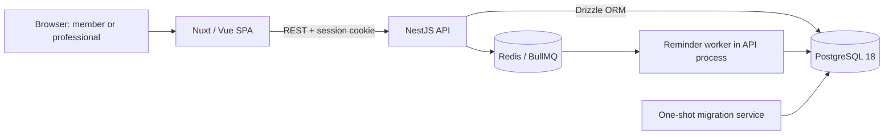

# ThoughtFull Booking

A booking app for members and mental-health professionals. Members can find professionals, book 50-minute sessions, and manage their bookings. Professionals manage working hours, blocked dates, profiles, and schedules. Both roles receive in-app notifications.

**Deployed app:** [thoughtfull.safwanzarif.dev](https://thoughtfull.safwanzarif.dev/)

## Prerequisites

- **Docker setup:** Docker Engine/Desktop with Docker Compose v2 and Linux containers. Node is not required to run the app this way.
- **Local setup and tests:** Node.js 26, its bundled npm, and Docker running for PostgreSQL, Redis, and isolated test infrastructure. Alternatively, local app development can use your own PostgreSQL 18 and Redis 7 instances.
- Keep ports **3000** (API), **3001** (frontend), **5432** (PostgreSQL), and **6379** (Redis) available for the default Compose setup.

Run commands from the repository root. Examples work in Bash/Git Bash/WSL or PowerShell 7. On Windows, `sh docker-update.sh` requires Git Bash or WSL.

## 1. Run with Docker

### Initial setup

Build and start the entire app, then add optional demo accounts:

```sh
docker compose up -d --build
docker compose exec api npm run db:seed
```

Compose starts PostgreSQL and Redis, runs pending database migrations, and then starts the API and frontend. If migrations fail, the API does not start. No environment-file setup or host npm installation is required for this path.

| Service    | URL                                 |
| ---------- | ----------------------------------- |
| Frontend   | http://localhost:3001               |
| Swagger    | http://localhost:3000/api/docs      |
| API health | http://localhost:3000/api/v1/health |

The database starts empty unless you run the seed command. Demo credentials are listed below.

### After updating code

```sh
docker compose up -d --build
```

This rebuilds changed images and applies pending migrations before restarting the API. Existing data is retained. Alternatively:

```sh
sh docker-update.sh
```

The script rebuilds and starts the complete stack, then follows API and frontend logs. Ctrl+C stops viewing logs; containers keep running.

Useful commands:

```sh
docker compose logs -f migrate api frontend
docker compose run --rm migrate
docker compose down
```

The migration command can be rerun safely: Drizzle records applied migrations and applies only pending ones. `down` stops the stack while retaining data.

### Start with an empty database

**This permanently deletes the Compose database and Redis data**, including accounts, bookings, and notifications:

```sh
docker compose down --volumes
docker compose up -d --build
```

Migrations recreate the schema. Run the seed command again only if you want demo data. Rebuilding images alone does not erase named volumes.

### Docker configuration

Defaults live in `compose.yaml`. The frontend is a static Nuxt SPA served by a non-root Node container, with fallback for deep links such as `/sessions`.

Its API URL is set at build time using `frontend.build.args.NUXT_PUBLIC_API_BASE`. This must be reachable by the **browser** (default `http://localhost:3000/api/v1`), rather than a Docker service hostname. If changing hostnames or ports, also update the API's `FRONTEND_ORIGIN` and `API_ORIGIN`, then rebuild. The supplied credentials are for local development.

## 2. Run locally

### Initial setup

Copy the example settings and install dependencies:

```sh
cp .env.example .env && cp frontend/.env.example frontend/.env && npm ci
```

Start only the infrastructure, migrate, build the API, and optionally seed demo data:

```sh
docker compose up -d postgres redis && npm run db:migrate && npm run build && npm run db:seed
```

If using your own PostgreSQL 18 and Redis 7 instead, skip the Compose command and update `DATABASE_URL`, `REDIS_HOST`, and `REDIS_PORT` in `.env` before migrating. PostgreSQL must allow installation of the `btree_gist` extension used by the overlap constraints.

Start the development servers in **two terminals**:

```sh
# Terminal 1: API on http://localhost:3000
npm run dev
```

```sh
# Terminal 2: frontend on http://localhost:3001
npm run dev:web
```

Use the same frontend, Swagger, and health URLs listed above. `.env` configures the API/database tools; `frontend/.env` configures the browser-facing API URL. Browser authentication uses cookies and the configured frontend origin.

### After updating code

Both development servers watch source files and reload automatically. If dependencies or migrations changed, stop the development servers and run:

```sh
npm ci && npm run db:migrate
```

Then restart `npm run dev` and `npm run dev:web` in their respective terminals. Restart after environment-file changes too. To refresh generated frontend API types after changing API DTOs or controllers, run `npm run gen:api`.

Do not run local development servers and the full Docker app on the same ports. You can keep the Compose PostgreSQL and Redis services running for local development.

## Demo accounts

All demo accounts use **`ThoughtFull-demo-2026!`**.

| Role                       | Email                 |
| -------------------------- | --------------------- |
| Member                     | `sam@example.test`    |
| Member                     | `jordan@example.test` |
| Professional, Kuala Lumpur | `aina@example.test`   |
| Professional, Kolkata      | `ravi@example.test`   |
| Professional, New York     | `taylor@example.test` |

The seed includes 15 fictional professionals with varied time zones, languages, specialisations, and weekly schedules. It can be rerun without duplicating accounts or replacing existing working hours. You can also sign up through the app; sign-up sends you to login.

## Run tests

Tests run on the host for **either setup path**. They require Node.js 26 and a running Docker daemon. Install dependencies and the Playwright browser once, then run all tests:

```sh
npm ci && npx playwright install chromium
npm run test:all
```

On Linux, Playwright may require browser OS libraries; use `npx playwright install --with-deps chromium`. To use an already installed Chrome instead, set `PLAYWRIGHT_CHANNEL=chrome` before running the tests (`$env:PLAYWRIGHT_CHANNEL='chrome'` in PowerShell, or `export PLAYWRIGHT_CHANNEL=chrome` in Bash).

`test:all` runs Vitest unit/integration tests, followed by Playwright desktop and mobile browser tests. Backend integration tests use disposable PostgreSQL/Redis containers. Browser tests build the frontend on port **3011** and start an isolated API/database on **3012**. They do not use or reset the development database. Keep those test ports free, and leave `PLAYWRIGHT_SKIP_API` unset for the full suite.

Individual checks:

```sh
npm test                  # Backend and frontend unit/integration tests
npm run test:browser      # Desktop/mobile browser tests
npm run lint              # ESLint and formatting
npm run typecheck:web     # Frontend TypeScript checks
npm run build             # Backend build
npm run build:web         # Static frontend build
```

Browser coverage includes cookie authentication, role guards, booking, cancellation, rescheduling, notifications, availability editing, session expiry, cross-tab logout, and the background-request logout race.

## Architecture



- **Frontend (`frontend/`):** Nuxt 4/Vue with Nuxt UI, saved light/dark preference, responsive member/professional layouts, and TypeScript API types generated from Swagger. The production container serves static assets; local development uses Nuxt's development server.
- **Backend (`backend/`):** NestJS modules separate authentication, professional discovery, availability, slots, bookings, notifications, and reminders. Versioned controllers validate request DTOs and document response/error DTOs in Swagger. Cookie-authenticated writes validate the origin; Swagger supports bearer authentication.
- **Persistence:** PostgreSQL stores users, professional profiles, sessions, working hours, blocked dates, reminders, notifications, and idempotency records. Booking/cancellation/reschedule changes use transactions and idempotency keys. Database exclusion constraints prevent overlapping active bookings for either participant.
- **Time and reminders:** Bookings store absolute instants; availability and blocked dates use the professional's saved IANA time zone. Working ranges use quarter-hour starts and whole-hour lengths, ending by midnight. Redis/BullMQ schedules reminder jobs; the worker creates in-app notifications. Booking and session-change notifications are persisted with the booking transaction.
- **Compose startup:** PostgreSQL/Redis health checks gate startup; the migration service must exit successfully before the API starts. Named volumes retain data between rebuilds.

Sessions last 50 minutes with a 10-minute gap between hourly starts. Members need at least two hours' notice to book and at least 24 hours to cancel or reschedule. Professionals can cancel their sessions. Blocking dates or replacing working hours keeps existing bookings and reports affected sessions for review.
